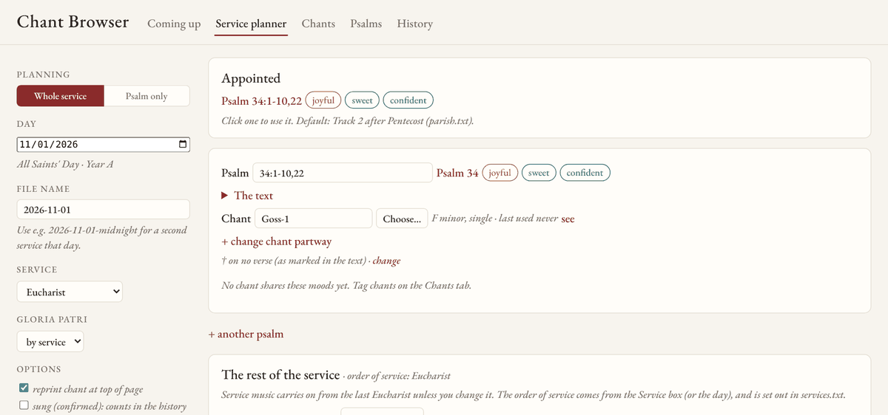
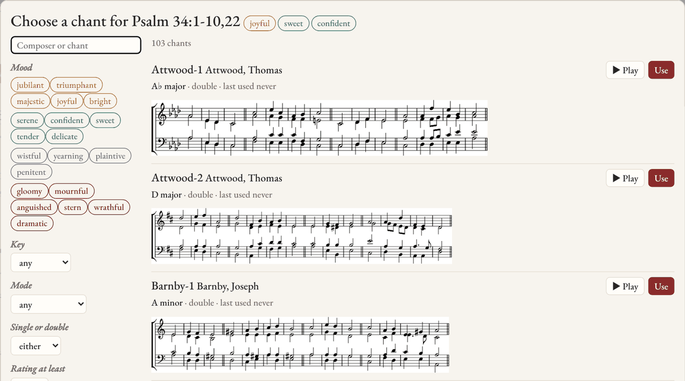
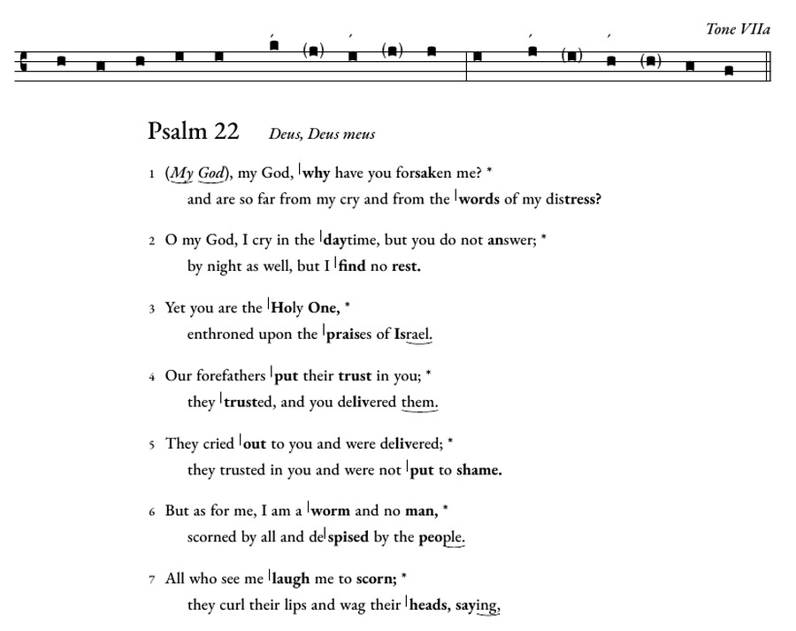
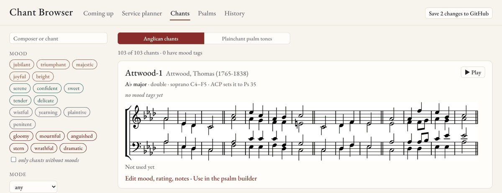

# Psalmody

Psalmody sets the psalms of the 1979 Book of Common Prayer for a parish choir, typeset with LilyPond, either to Anglican chant or to the Gregorian psalm tones. Texts and chants are kept apart, so any text can be sung to any chant. One short text file per Sunday becomes the choir's copy (a PDF) and cropped images for the service leaflet. A planner that runs in your web browser opens on the psalm the lectionary appoints, helps choose a chant by mood, key and when it was last sung, and keeps the rest of the service (hymns, anthems, voluntaries, service music) as the parish's record of what was sung.

It was built for the weekly use of one parish, St. Peter's Episcopal Church in Cambridge, Massachusetts, and is shared in case it helps others. To look around first, there's a [demo of the chant browser](https://choyun1.github.io/psalmody/) for a made-up parish (it can't save). Anything particular to a parish lives in its own folder, apart from the tools, and a parish can add to the planner with plugins of its own.

<!-- Contents: one entry per ## section, in order (tools/check_readme.py checks it). -->
<table><tr><td>

<small><b>Contents</b><br>
1&ensp;Using it<br>
&emsp;1.1&ensp;[What it's for](#what-its-for)<br>
&emsp;1.2&ensp;[Getting started](#getting-started)<br>
&emsp;1.3&ensp;[Gallery](#gallery)<br>
2&ensp;Each week<br>
&emsp;2.1&ensp;[Planning a service](#planning-a-service)<br>
&emsp;2.2&ensp;[From the command line](#from-the-command-line)<br>
3&ensp;Reference<br>
&emsp;3.1&ensp;[Orders of service](#orders-of-service)<br>
&emsp;3.2&ensp;[Plainchant psalm tones](#plainchant-psalm-tones)<br>
&emsp;3.3&ensp;[The text format](#the-text-format)<br>
&emsp;3.4&ensp;[The chant browser](#the-chant-browser)<br>
&emsp;3.5&ensp;[Your parish folder](#your-parish-folder)<br>
4&ensp;The project<br>
&emsp;4.1&ensp;[Roadmap](#roadmap)<br>
&emsp;4.2&ensp;[Credits and license](#credits-and-license)</small>

</td></tr></table>

## What it's for

- **The texts.** All 150 psalms and the 21 canticles of the Daily Office in the words of the 1979 BCP, checked word for word against it, in a plain-text format anyone can edit.
- **Anglican chant.** 103 public-domain chants, single and double, with a catalog (composer, dates, key, mode) and notation and playback for each. The build checks that a double chant comes out even, lets the second half repeat († on a verse) fall where the Sunday needs it, and shows how the key moves at a change of chant.
- **Plainchant.** The Gregorian psalm tones of the Liber usualis, every tone and ending, set to any text automatically by the natural stress of the words, with the intonation and flex.
- **The lectionary.** The psalms appointed by the Revised Common Lectionary (Episcopal), Years A, B and C, both tracks, with the verses as printed, optional verses included.
- **Choosing.** Mood tags on every psalm and on any chant you tag, matched against each other; what you sang last time on the same Sunday of the lectionary; how long since each chant was used.
- **The record.** The whole service, every Sunday: the history of every chant, hymn and anthem, for planning and for downloading as a table.

**Pointing.** The texts here are unpointed, because the pointing in printed psalters (the Anglican Chant Psalter and others) is the publishers' work and can't be shared. The plainchant tones need no pointing. For Anglican chant, point the psalms you sing in the browser's pointing editor (or by hand, in the [text format](#the-text-format)); your pointing is saved in your parish folder.

## Getting started

1. Install Python 3.9 or later and [LilyPond](https://lilypond.org) (2.26 is what the spacing is tuned for; another version works, with a note). If `lilypond` isn't on the PATH, set the `LILYPOND` environment variable to it.
2. Download this repository and double-click **Psalter.bat** (Windows) or run `psalter.sh` (Linux, macOS). It installs the Python packages it needs (`requirements.txt`) and opens the chant browser in your web browser. Everything stays on your computer; close the launcher's window to stop.
3. The first time, the chant browser asks your parish's name, its lectionary track, its patronal feast and whether to sing the bracketed verses, and makes your parish folder, `parish/` (or run `python tools/setup.py`, or copy `parish.example/` to `parish/` by hand). It holds your Sunday files, pointing, ratings and history, and this repository ignores it; it's a git repository of its own, for Undo, and once you give it a private copy on GitHub, **Sync** keeps the two alike. Everything it asked can be changed later in `parish/parish.txt`, along with the liturgical colors, the Christmas psalms and any plugins.

## Gallery

**The service planner.** Pick a date: the appointed psalm comes up with its mood tags, then the chant, the † and the rest of the service, laid out by that day's order of service.



**Choosing a chant.** Every chant in notation, with playback, filtered by mood, key, mode or rating and sorted by best match for the psalm, key or longest since used. The plainchant tones are offered too.



**A plainchant page.** The tone on a four-line staff, then every verse pointed for it in words: a stroke where the cadence begins, the accented syllables in bold, the intonation in brackets. ([the whole PDF](docs/examples/psalm-22-tone-VIIa.pdf))



**The Psalms tab.** Every text, pointed. With the launcher, tick *edit the pointing* and click a verse to change it for good; the text as it was before its first change is kept (`parish/texts/originals/`), changed verses are marked ✱, and the original can always be put back.

**The Chants tab.** Every chant in a list, with its key, your rating, when you last used it and its moods; click a column's heading to sort by it (again to reverse), and a chant to open it: the music, Play, the psalm the Anglican Chant Psalter sets it to, and your notes (where a chant they mention, Turle-2, shows by its name, Turle in D minor). A chant with no moods yet shows suggested ones (dashed): a guess from its mode, its tune, the psalms the ACP sets it to and the moods you've given others, to take with a click (`python tools/moodsuggest.py --check` says how often it agrees with yours).



## Planning a service

Double-click **Psalter.bat** and open the **Service planner** tab.

1. **Pick the date.** The lectionary psalm is filled in (in the Season after Pentecost, the track set in `parish.txt` first); *The text* opens exactly the verses appointed.
2. **Choose a chant.** **Choose…** opens the picker; click **Use**. The menu beside it transposes the chant for this Sunday (C minor, down 2): the PDF prints it in that key, and ▶ Play plays it there (`chant: Turle-2 down 2` in the Sunday file). Chants are shown as service sheets name them, *Turle in D minor*, with a number where one composer has two in a key; the file name (Turle-2) stays underneath. Add a change of chant partway, or another psalm, the same way. Verses the lectionary prints in brackets (`90:1-8,(9-11),12`) are left out unless you tick *sing the optional verses* (the default is `optional_verses:` in `parish.txt`). In *The text*, click a verse number to put the † on it or take it off, for this Sunday only, and ✎ beside a verse to point it differently for this service only (a `verse:` line in the Sunday file; the text keeps its own pointing, and the build checks the words still match the BCP); the planner says at once whether each double chant comes out even.
3. **Check it.** *Preview* shows the page straight away; **Exact PDF preview** runs LilyPond and shows the real thing. *Before on Proper 27* shows what was sung the last time these readings came round, three or six years ago, and the same day in the other years of the cycle.
4. **The rest of the service.** Fill in the prelude, hymns, anthems and postlude. Type a hymn number (`390`, `LEVAS 114`) and its title appears with when it was last sung; the voluntary and anthem boxes suggest everything done before; service music carries on from the last service of the same kind. Paste an anthem's words once and they're kept in `parish/anthems/`.
5. **Save & build.** The PDF and the images for the leaflet appear as links. Any cards your parish's plugins add (a weekly email, a music schedule) come below.
6. **Sync with GitHub.** Saving keeps everything on your computer at once, and Undo works without GitHub. The button at the top (the number on it is how many changes aren't online yet; a green ✓ when there are none) asks right beside it, then syncs; the ⓘ next to it says why. Syncing does three more things: a **backup** of your parish folder in your own GitHub account; your **other computers**, whose changes come here and yours go there (sync before you switch computers); and **updates** to the tools (restart the launcher after).

**Undo.** Every save is kept on your computer as you go: a Sunday, chant notes or a pin, a verse's pointing, an anthem's words, marking a service as sung. **↶ Undo** at the top takes back the last one; **Changes** lists them all, newest first, each with its own Undo. An undo is a change too, so it can be undone. (This uses git in your `parish/` folder; if that folder isn't a git repository yet, the launcher starts one there, kept on your computer only.)

**Liturgical colors.** A dot beside each date in Coming up, the planner and History shows the day's color: the Episcopal Church's customary ones, by season, with the feasts that take their own. A parish changes any of them in `parish.txt` (`season_colors:`, `day_colors:`, `color_shades:`).

**No choir this week** (under Options) is for the Sundays the psalm is said: the chant boxes give way, there's nothing to build, and the history and Coming up show "no choir" (`choir: no` in the Sunday file).

**Psalm only**, at the top, hides the rest of the service: for a rehearsal or a one-off, with or without a date. A service in a free order (Lessons and Carols: lessons, hymns and carols in any order) shows as a list to add to and rearrange, starting from last year's if you like; lessons are numbered for you.

## From the command line

```
python tools/new_sunday.py 2026-11-08            # start the Sunday's file from the lectionary
python tools/build.py parish/sundays/2026-11-08.txt
```

`new_sunday.py` writes the day, the appointed psalm and the alternatives, and suggests chants whose moods suit the text, leaving out any used in the last twelve weeks:

```
# Proper 27, Year A (Track 2)
date:    2026-11-08
psalm:   70
#   or:  78:1-7
chant:   ???                       # pick one; ideas below
```

To change chant partway, add `chant: Smart-1 from 9`; for a psalm tone, `tone: 7a`. For Evensong or the Office, `service: Evensong` switches the Gloria Patri on (`gloria: yes` or `no` overrides it). Psalm lines take lectionary citations as printed: `72:1-7,18-19`, `34:1-8,(19-22)`, `119:9-16`. `examples/` has a worked example of every situation.

The build prints its checks (double chants coming out even, keys at a change of chant), then writes to `parish/output/2026-11-08/` the choir's PDF (a chant is printed again at the top of a page when its verses continue there), the LilyPond file behind it, and the cropped images, numbered in the order they're sung. `--check` shows only the checks; `--pdf-only` skips the images. `python tools/lectionary.py 2026-11-08 8` lists the next eight Sundays' psalms.

**Links to the readings.** Wherever the planner names a day (Proper 27, Year A), it links to that day on the Episcopal Church's lectionary site. The site numbers its pages, so `python tools/lectionary_links.py` reads its month pages once and keeps the numbers in `reference/lectionary_links.csv` (the launcher runs it the first time); a day it hasn't found yet links to its month's calendar.

## Orders of service

What music a service has is written down once, in `services.txt`: one block per kind of service, one line per piece in the order it happens.

```
Evensong
  prelude:    Prelude
  opening:    Opening hymn                (hymn)
  preces:     Preces & Responses
  canticles:  Magnificat & Nunc dimittis
  anthem:     Anthem                      (anthem)
  closing:    Closing hymn                (hymn)
  postlude:   Postlude
```

The kind says how to treat what you type: `hymn` (hymn numbers, one or several), `anthem` (a hymn, or a piece whose words are kept), `service` (service music, carried on from the last service of that kind), `lesson` (a reading), or nothing for anything else. `optional` hides a box until you ask for it (the Kyrie, in Lent); `words=magnificat` attaches fixed words to whatever setting is sung; `repeat` lets a piece come any number of times. The file comes with Eucharist, Evensong, Ash Wednesday, Palm Sunday, Maundy Thursday, Good Friday, the Easter Vigil and Lessons and Carols. A parish that does things differently copies it to `parish/services.txt` and changes it. A Sunday file picks its order with `service: Evensong`; without one, the order named like the day (Palm Sunday, Christmas Eve), else the first.

In the Sunday file, the music goes under the same names (`examples/11-whole-service.txt`):

```
organist:  AYC
prelude:   Voluntary in A minor - Orlando Gibbons (1583-1625)
opening:   390                  # The Hymnal 1982 unless another book is named
gradual:   LEVAS 114
communion: O come, ye servants of the Lord - Christopher Tye (1505-1573)
gloria in excelsis: S278
also:      Processional hymn: 787 (WLP)
note:      The choir will sing from the gallery.
```

Hymn titles come from hymnal indexes (`<BOOK>.csv`, columns `number,title`, in `reference/hymnals/` or `parish/hymnals/`); your own wording goes in `parish/hymn_titles.csv`. The Sunday files are the music record: the History tab, hymn histories and the planner's suggestions read them, and `python tools/service.py record` writes the lot, one row per piece, to `parish/schedule/record.csv`.

## Plainchant psalm tones

Put `tone: VIIa` (or any tone and ending of the Liber usualis: `1D`, `8G`, `4E`, `per`…) in place of `chant:`, or choose a tone and then one of its endings in the planner. The Chants tab's *Plainchant psalm tones* view shows each tone once, with its endings side by side, in notation, with playback and the mode's traditional character. A tone's endings all share its first half; the Liber picks one to lead back into an antiphon, and without one the choice is yours. (Endings belong to their own tone: one tone's ending with another's mediant isn't a traditional tone.)

The page prints the tone on a four-line staff with square notes, then every verse pointed for it in words: a short stroke where the cadence begins, **bold** for the accented syllables, a small slur under a syllable sung to more than one note, † for a flex, and the intonation in brackets and italic, *(My God),* my God, why have you forsaken me? The intonation is sung on the first verse only, unless you tick *sing the tone's intonation on every verse* (`intonation: every verse`). When the last accent falls on the final syllable, the cadence stops on it. The accents follow the natural stress of the words, from a pronouncing dictionary, so no pointing is needed. The tone formulas (`reference/psalm_tones.json`) are from the public-domain jgabc project, checked against the Liber usualis.

## The text format

```
Psalm 19 | Caeli enarrant

1   The heavens declare the | glory . of | God, *
      and the | firma- . -ment | shows his | handiwork.

14  Let the words of my mouth and the meditation of my
    + heart be ac- | -ceptable . in your | sight, *
      O LORD, my | strength and | my re- | -deemer.
```

| Mark | Meaning |
|---|---|
| `\|` | bar line |
| `.` (standing alone) | the next note within the bar; two or more syllables on one note get a bracket |
| `*` | the mediant: lines up to and including the `*` are the first half of the verse |
| `=word` | a held syllable, sung to both notes of the bar |
| `re- \| -vives` | a word divided by the pointing; prints as re'vives |
| `—` | an empty bar |
| `†` before the verse number | sing this verse to the second half of the chant again |
| `+` at the start of a line | a long line running over |
| `%` at the start of a line | a comment |

LORD, GOD and YAHWEH are set in small capitals automatically, and straight quotes become curly ones. `python tools/check_texts.py` reports any word that differs from the 1979 BCP and any verse without exactly one `*`. Every typographic choice (typeface, bar height, brackets, indents, verse spacing) is a named setting at the top of `style/psalm-style.ily`.

## The chant browser

- **Coming up**: the next Sundays and feasts, one line each; click one for its psalms, moods and chant ideas.
- **Service planner**: [above](#planning-a-service).
- **Chants**: every chant in notation with playback, filtered by mood, mode, key and rating; and the plainchant tones.
- **Psalms**: every text with its mood tags, the chants that match them best, and what it was sung to before.
- **History**: every pairing on record, and every whole service, with **Download the whole record (CSV)**. A Sunday joins the history once it's marked as sung.

**Moods.** Psalms and chants share one vocabulary (`moods.txt`) in four families: bright, calm, shadowed and dark. A chant scores fully for each mood it shares with the text and partly for one in the same family; the text's first tag counts most; ties go to the higher rating, then to the chant used least recently. Tag chants with *Edit mood, rating, notes* on the Chants tab. The psalm tags (`texts/moods.csv`) were assigned by reading each psalm, then checked against the NRC emotion lexicon; correct them as you see fit.

`python tools/browser.py` rebuilds the page after you change the catalog, moods, texts or Sunday files (drawing notation only for new chants). The page also opens straight from the folder, offline; building and saving need the launcher.

## Your parish folder

| In `parish/` | |
|---|---|
| `parish.txt` | Name, lectionary track, patronal feast, Christmas psalms, optional verses, liturgical colors, and any plugin's settings. |
| `sundays/` | One file per Sunday or service. |
| `texts/` | Your pointed texts, in place of the unpointed ones; pointing done in the browser is saved here. |
| `services.txt` | Your own orders of service, if they differ. |
| `chant_notes.csv` | Your ratings, mood tags and notes on every chant. |
| `chants/` | Chants you may not publish (still under copyright), with their own `catalog.csv`. |
| `anthems/`, `hymnals/`, `hymn_titles.csv`, `lessons.csv` | Anthem words, hymnal indexes, your hymn titles, readings for Lessons and Carols. |
| `schedule/schedule.csv` | Past services brought in from elsewhere (date, occasion, organist, slot, item), read with the Sunday files. |
| `plugins/` | Your own additions to the planner (below). |
| `output/`, `site/` | What the build makes, and the chant browser built for your parish. |

**Plugins.** A parish's own ways of doing things (a weekly email to the office, a music schedule spreadsheet, a volunteer schedule) belong in its folder, not here. A plugin is a folder in `parish/plugins/` with up to three files: `plugin.txt` (lines it adds to Sunday files and orders of service), `plugin.py` (requests it answers for the planner) and `plugin.js` (a card or rows it adds to the planner). `tools/plugins.py` describes them. St. Peter's has two: its weekly email to the parish office, drafted in Gmail with the psalm images attached, and its music schedule, a Google Sheet each service is written into.

In this folder: `texts/` and `chants/` (with `catalog.csv`), `moods.txt`, `services.txt`, `examples/`, `style/` (the LilyPond settings and EB Garamond), `reference/` (the 1979 psalter, the lectionary's psalm table, the psalm tones), `tools/` (the chant browser's page is in `tools/browser/`), `tests/` (`python -m unittest discover tests`, which with music21 installed also checks the MusicXML import against every chant and Bach's chorales; `node tests/ui_check.mjs` walks through the chant browser in a headless browser, as GitHub does on every push) and `parish.example/`. To add a chant, use **+ New chant** on the Chants tab (with the launcher): its composer and source, then the music, voice by voice, with a picture that redraws as you type and Play; it goes in `chants/` with a row in `chants/catalog.csv`, or in `parish/chants/` if it's still under copyright. A chant already typeset in MuseScore, Finale, Sibelius or Dorico can start from its MusicXML export (*Start from a score*): the four voices (as four parts, two staves of two voices, two staves of chords, or a mixture; parts named Soprano, Alto, Tenor and Bass are found by name, and an organ part is left out), the key, the time and the composer come in, with a warning for anything to check, ready for the editor (`python tools/musicxml.py score.musicxml` prints the chant file it makes). **Edit details** and **Edit music** on a chant correct it the same way (and **edit the music** under a chant in the planner's preview); ⚑ marks one *to check*. By hand, copy a chant file in the layout of the others and add its catalog row. A chant that turns out to be a copy of another, in another key, can go in `chants/aliases.csv` instead: its old name then means the other chant, transposed, wherever it's used.

## Roadmap

- **Pointing that can be shared.** Automatic Anglican-chant pointing from word stress, as the plainchant tones already have, checked against printed psalters, so that every psalm comes pointed.
- **The plainchant tones.** An audit of the tone pointing against printed English plainsong psalters, and a way to move an accent by hand.
- **More parishes.** More hymnals; other psalters (Coverdale, Common Worship) and lectionaries.
- **The corpus.** The chants in LilyPond and MusicXML with their metadata, as a dataset, and the studies it allows: keys and ranges across composers and periods, whether mood tags follow from musical features, and automatic pointing.

Maybe later:

- **Performance marks on the choir copy**, as some printed leaflets have: who sings each verse (Full, Decani, Cantoris) and its dynamic in the margin, a boxed "2nd half" in place of the †, a "new chant" warning box where the chant changes, and ✓ breath marks within long lines.

## Credits and license

Psalmody grew out of the LilyPond files Adrian Cho made to set the psalms each week at St. Peter's, Cambridge, and was developed with Claude (Anthropic) in 2026.

The code is under the MIT License ([LICENSE](LICENSE)). The mood tags, the chant catalog and the other data are under Creative Commons Attribution 4.0 ([LICENSE-DATA.md](LICENSE-DATA.md)). The psalm texts are from the 1979 Book of Common Prayer, which is in the public domain, as are the chants included here. The canticle texts were taken from the Venite project (MIT) and checked against bcponline.org; the Gloria in excelsis and the Te Deum, printed as prose in the BCP, are divided into verses for chanting by the editor. The psalm tones come from the jgabc project (public domain). The EB Garamond fonts are under the SIL Open Font License (`style/fonts/OFL.txt`).
